<p align="center">
  <picture>
    <source media="(prefers-color-scheme: dark)" srcset="docs/assets/banner-dark.png">
    <source media="(prefers-color-scheme: light)" srcset="docs/assets/banner-light.png">
    
  </picture>
</p>

<p align="center">
  
  
  
</p>

# Agamemnon: frame-level ball possession from automatic tracking

Agamemnon labels every frame of a football match as home possession, away possession or dead ball,
using only automatic player and ball tracking plus automatic tactical tags.

It was built for Phase 1 of [More than a Hack 2027](https://github.com/metrica-sports/more-than-a-hack-2027),
organised by Metrica Sports, FC Barcelona and the Mobile World Capital Barcelona, where the task is
to label all 199,319 frames of FC Barcelona vs Athletic Club and the ranking metric is `spellF1`
(possessions matched one-to-one by temporal overlap). This is an independent team project and is
not affiliated with or endorsed by the organisers, FC Barcelona or Metrica Sports.

## How it works

```mermaid
flowchart LR
    ATD[ATD tracking<br/>ball + 46 slots] --> F[features.py<br/>proximity, touches,<br/>team shape, stoppage]
    ST[Smart Tagging] --> T[deadball.py<br/>set-piece / goal windows,<br/>phase team prior]
    F --> N[temporal CNN<br/>P&#40;H&#41;, P&#40;A&#41;, P&#40;D&#41; per frame]
    T --> N
    N --> V[3-state Viterbi<br/>switch penalties]
    V --> S[snap hand-overs<br/>to taker's touch]
    S --> CSV[frame,label CSV]
```



1. **Features.** Distances from the ball to the nearest player of each side, ball touches
   detected from abrupt velocity changes (who touched last and who touches next), team spread and
   field position, collective player speed, out-of-bounds and kick-off set-ups. Slots carry no
   identity, so everything is computed per team.
2. **Emissions.** A small dilated 1-D convolutional network turns about 20 s of context around
   each frame into probabilities of home, away and dead. It is trained only on external matches
   (below), with tracking degraded to look like uncorrected automatic tracking.
3. **Decoding.** A three-state Viterbi with fitted switch penalties gives whole possessions
   instead of flickering frame labels; each hand-over is then moved to the first touch of the team
   taking over.

The possession and dead-ball rules, and how external labels are mapped onto them, are in
[docs/POSSESSION_RULES.md](docs/POSSESSION_RULES.md). Every constant, with its source, is in
[docs/PRIORS.md](docs/PRIORS.md).

## Results

Benchmark results are added once the configuration is locked; see [docs/BENCHMARK.md](docs/BENCHMARK.md).

## Reproduce

Python 3.12, CPU only. Put the match bundle in `data/` as described in [DATA.md](DATA.md), then:

```bash
pip install -r requirements.txt && pip install -e .
python -m agamemnon.pipeline --out evaluation/results/Agamemnon.csv
python evaluation/validate_submission.py evaluation/results/Agamemnon.csv
```

or `bash scripts/reproduce.sh`, which does the same and prints the md5 of the file.

The external benchmark (downloads about 4.5 GB):

```bash
python scripts/fetch_external.py && python scripts/build_cells.py && python scripts/run_bench.py
```

Retraining the network needs PyTorch (`requirements-train.txt`) and preferably a CUDA GPU:
`python scripts/train_tcn.py --final`.

## Repository

```
src/agamemnon/      loader, features, deadball, decoder, tcn (numpy inference), labels, pipeline
  external/         IDSSE and SkillCorner converters, label mapping, degradation, benchmark
  models/tcn.json   trained network weights
scripts/            reproduce.sh, fetch_external, build_cells, run_bench, tune, train_tcn,
                    sanity_report, inspect_schema, priors_table
tests/              synthetic tests for every parser, converter and decoder step
docs/               possession rules, priors, external data, benchmark, technical report
evaluation/ starter/ games.py   from the organisers' starter kit (MIT), unchanged
```

## Team

| | | |
|---|---|---|
| Naufal Fahrozi | team lead, systems architecture | [@NaufalFahrozi](https://github.com/NaufalFahrozi) |
| Raymond Thymotimmanuel | football domain, possession rules | [@Rodexxx24](https://github.com/Rodexxx24) |
| Tua Delima Sitompul | data science, benchmark and models | [@delima-sitompul](https://github.com/delima-sitompul) |

Universitas Mulawarman.

## Licence and attribution

Code: MIT ([LICENSE](LICENSE)). The organisers' starter kit (`evaluation/`, `starter/`, `games.py`
and the challenge documents) is MIT, © Metrica Sports, and is included unchanged. The match data is
not in this repository and is not covered by either licence.

External data used for training and tuning:

- **IDSSE**: Bassek, M., Rein, R., Weber, H., Memmert, D. An integrated dataset of spatiotemporal
  and event data in elite soccer. *Scientific Data* 12, 195 (2025).
  [doi:10.1038/s41597-025-04505-y](https://doi.org/10.1038/s41597-025-04505-y). Data © DFL Deutsche
  Fußball Liga, CC BY 4.0.
- **SkillCorner Open Data**, A-League 2024/25 broadcast tracking, MIT. Data courtesy of
  [SkillCorner](https://github.com/SkillCorner/opendata).
