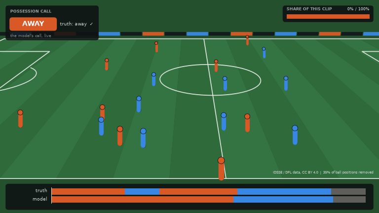
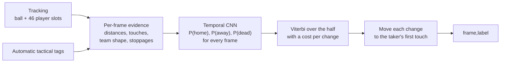

<p align="center">
  <picture>
    <source media="(prefers-color-scheme: dark)" srcset="docs/assets/banner-dark.png">
    <source media="(prefers-color-scheme: light)" srcset="docs/assets/banner-light.png">
    
  </picture>
</p>

<p align="center">
  <a href="https://github.com/agamemnon-labs/football-analytics/actions/workflows/tests.yml"></a>
  
  
</p>

# Who has the ball?

Sounds like the easiest question in football. Then you try to answer it 25 times a second, for a
whole match, from a computer that can't see the ball half the time.

That's what this repo does. Feed it automatic player and ball tracking, and for every single frame
it tells you: home team has it, away team has it, or the ball's dead. Stitch those frames together
and you get every possession of the match, with when it started, when it ended and whose it was.

We built it for Phase 1 of [More than a Hack 2027](https://github.com/metrica-sports/more-than-a-hack-2027),
run by Metrica Sports, FC Barcelona and the Mobile World Capital Barcelona. The job: label all
199,319 frames of FC Barcelona vs Athletic Club. The scoreboard uses `spellF1`, which cares about
getting whole possessions right, not individual frames. (Quick disclaimer: this is our own team
project, not affiliated with or endorsed by the organisers, FC Barcelona or Metrica Sports.)

<p align="center">
  
</p>

<p align="center">
  <a href="https://agamemnon-labs.github.io/football-analytics/"><b>Play with the live demo</b></a>: scrub the match,
  switch cameras, and take the ball away from the model to see how it copes.
</p>

<sub>Thirty seconds of a Bundesliga match from our external benchmark, re-drawn from tracking data
through a TV-style camera that follows the ball. The box top left is the model's call, live, next to
the truth. We deleted about a third of the ball positions on purpose, because that's what automatic
tracking feels like in real life; when you see "ball not tracked", the model is flying blind. Yes, we
miss that short blue possession in the middle. More on that below. There's no real footage here: the
Barcelona match can't be published, and the open datasets we use come without video.</sub>

## Why it's harder than it looks

The obvious first try is "whoever's closest to the ball has it". It works great until it doesn't,
which is roughly every ten seconds:

- The ball goes missing on about 40% of the frames we have to label. Schrödinger's football.
- A long ball spends two seconds in the air, near nobody. Who has it? Technically the team that
  kicked it.
- A defender sticks a leg out and gets a touch without winning it. That's not a turnover, even if
  the replay makes it look like one.
- Throw-in. Everyone's standing around the ball, but play is stopped.

And the metric doesn't forgive. If our labels flicker to the other team for half a second, one
correct possession becomes three wrong ones. Picture a VAR check that keeps changing its mind; that's
what a twitchy model looks like to `spellF1`.

So we don't make the call frame by frame. We collect evidence for every frame, then ask "what's
the most believable story for this whole half?", charging a fee every time possession switches. A
couple of frames of weird evidence aren't worth paying that fee twice. A proper turnover is.

## How it works



Here's the same thirty seconds from above, the way the pipeline actually thinks about it:

<p align="center">
  
</p>

### 1. Gather clues

For every frame we work out how far the ball is from each team's nearest player,
who touched it last and who touches it next (a touch is the ball suddenly changing speed or direction
with someone close enough to have done it), how spread out each team is, whether everyone's walking
like the ref just blew the whistle, and whether the ball crossed a line. All of it is computed per
team, never per player, because automatic tracking loves swapping player IDs mid-match. The tactical
tags chip in with where the set pieces and goals were.

### 2. Let a small network read the room

A 1-D convolutional network looks at about twenty seconds
either side of each frame and turns the clues into three probabilities: home, away, dead. It has
never seen the Barcelona match. It learned from 27 other matches, and we made their tracking worse
on purpose so it would get used to the mess.

### 3. Pick the story

A Viterbi decoder finds the best sequence of home, away and dead ball for each
half. The switching fee is the thing that stops possessions from flickering.

### 4. Tidy the edges

Each change of possession gets nudged to the first touch of the team taking
over, because that's when it actually happened.

Here's what that looks like over the first ten minutes of the same Bundesliga match. Notice how
patchy the bottom row is: that's how often the ball was actually visible.

<picture>
  <source media="(prefers-color-scheme: dark)" srcset="docs/assets/timeline-dark.png">
  
</picture>

Where we drew the line on loose balls, 50/50s and restarts is written up in
[docs/POSSESSION_RULES.md](docs/POSSESSION_RULES.md). Every magic number in the code, and where it
came from, is in [docs/PRIORS.md](docs/PRIORS.md). No magic numbers were tuned on the Barcelona
match. That's against the rules, and honestly it would be cheating ourselves too.

## How good is it?

Everything was trained and tuned on 27 matches that aren't the competition match: 7 from the
Bundesliga (IDSSE) and 20 from the A-League (SkillCorner). Every match got scored by a version of
the network that had never seen it, so no peeking.

<picture>
  <source media="(prefers-color-scheme: dark)" srcset="docs/assets/benchmark-dark.png">
  
</picture>

The model we submitted scores a `spellF1` of 0.681 on those matches (0.585 on its worst match, 0.774
on its best) and a `macroF1` of 0.908. Our first version, a pair of logistic regressions, got 0.501.
The tactical tags are worth about 0.09; take them away and we still get 0.62.

On the public five minutes of the actual match, which we ran exactly once, after locking every
parameter (commit `f30c2ba`), we got 0.519 `spellF1` and 0.845 `macroF1`. The organisers' best
baseline gets 0.424 and 0.581. Before anyone gets excited: five minutes is only 17 possessions, so
that number could be anywhere from 0.31 to 0.71. It tells us the pipeline isn't broken, not who wins.
The real score gets computed by the organisers on the full match, which none of us can see.

The honest weak spot: we merge short possessions. On those five minutes we found 10 possessions where
there were 17. Lowering the switching fee would split more of them, but on the 27 training matches
that actually makes the score worse, so we left it. Details, ablations and a stability check are in
[docs/BENCHMARK.md](docs/BENCHMARK.md) and the [technical document](docs/TECHNICAL_REPORT.md).

## Run it yourself

Python 3.12 and a laptop CPU are plenty. The match data isn't public, so it isn't in here; drop the
bundle into `data/` as described in [DATA.md](DATA.md), then:

```bash
pip install -r requirements.txt && pip install -e .
python -m agamemnon.pipeline --out evaluation/results/Agamemnon.csv
python evaluation/validate_submission.py evaluation/results/Agamemnon.csv
```

Takes about 12 seconds. Or run `bash scripts/reproduce.sh`, which runs the tests first and prints
the md5 of the result. Clone it fresh on another machine and you get the same file, byte for byte.

Want to rebuild the benchmark (about 4.5 GB of downloads) and the figures on this page?

```bash
python scripts/fetch_external.py && python scripts/build_cells.py && python scripts/run_bench.py
python scripts/make_figures.py && python scripts/make_broadcast.py
```

Retraining the network needs PyTorch (`requirements-train.txt`) and ideally a CUDA GPU; ours trained
on a laptop RTX 4050 in about 14 minutes. The full recipe is in [docs/BENCHMARK.md](docs/BENCHMARK.md).
Long runs can be paused and resumed with `scripts/jobctl.py`, which exists because one of us had to
leave a cafe in the middle of a training run.

## What's where

```
src/agamemnon/      loader, features, deadball, decoder, tcn (numpy inference), labels, pipeline
  external/         IDSSE and SkillCorner converters, label mapping, degradation, benchmark
  models/tcn.json   the trained network
scripts/            reproduce.sh, data download, training, tuning, ablations, figures, reports
tests/              parsers, converters and decoder on synthetic data, plus an end-to-end check
docs/               possession rules, priors, external data, benchmark, technical document
evaluation/ starter/ games.py   the organisers' starter kit (MIT), unchanged
```

## The squad

| | | |
|---|---|---|
| Naufal Fahrozi | team lead, the plumbing | [@NaufalFahrozi](https://github.com/NaufalFahrozi) |
| Raymond Thymotimmanuel | football brain, possession rules | [@Rodexxx24](https://github.com/Rodexxx24) |
| Tua Delima Sitompul | data science, models and benchmarks | [@delima-sitompul](https://github.com/delima-sitompul) |

## Licence and credits

Our code is MIT ([LICENSE](LICENSE)). The organisers' starter kit (`evaluation/`, `starter/`,
`games.py` and the challenge documents) is MIT, © Metrica Sports, and is included unchanged. The
competition data is covered by neither licence and isn't here.

Big thanks to the people who made their data open. The model learned everything it knows from:

- IDSSE: Bassek, M., Rein, R., Weber, H., Memmert, D. An integrated dataset of spatiotemporal and
  event data in elite soccer. *Scientific Data* 12, 195 (2025).
  [doi:10.1038/s41597-025-04505-y](https://doi.org/10.1038/s41597-025-04505-y). Data © DFL Deutsche
  Fußball Liga, CC BY 4.0. Every figure on this page is drawn from it.
- SkillCorner Open Data, A-League 2024/25 broadcast tracking, MIT. Data courtesy of
  [SkillCorner](https://github.com/SkillCorner/opendata).
