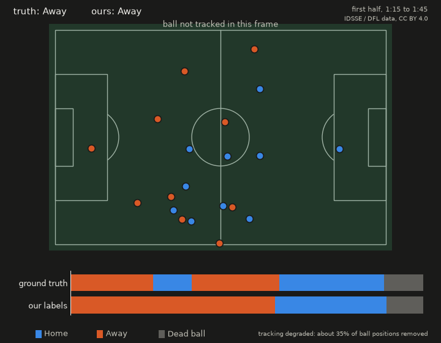
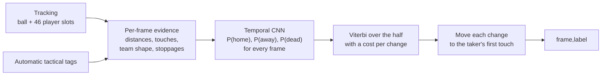
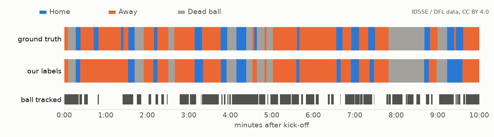
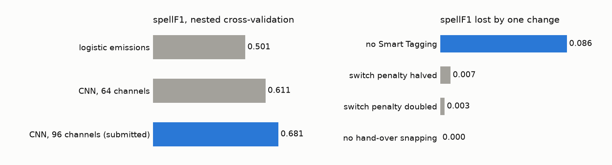

<p align="center">
  <picture>
    <source media="(prefers-color-scheme: dark)" srcset="docs/assets/banner-dark.png">
    <source media="(prefers-color-scheme: light)" srcset="docs/assets/banner-light.png">
    
  </picture>
</p>

<p align="center">
  <a href="https://github.com/agamemnon-labs/football-analytics/actions/workflows/tests.yml"></a>
  
  
</p>

# Who has the ball?

Agamemnon reads automatic player and ball tracking from a football match and says, for every one of
its 25 frames per second, whether the home team has the ball, the away team has it, or play is
stopped. From those frame labels you get every possession of the match: when it started, when it
ended, and which team had it.

We built it for Phase 1 of [More than a Hack 2027](https://github.com/metrica-sports/more-than-a-hack-2027),
organised by Metrica Sports, FC Barcelona and the Mobile World Capital Barcelona. The task there is
to label all 199,319 frames of FC Barcelona vs Athletic Club, and submissions are ranked by
`spellF1`, which rewards getting whole possessions right rather than individual frames. This is an
independent team project and is not affiliated with or endorsed by the organisers, FC Barcelona or
Metrica Sports.

<p align="center">
  
</p>

<sub>Thirty seconds of a Bundesliga match from the external benchmark, drawn from the tracking the
model actually receives: about a third of the ball positions have been removed to imitate automatic
tracking. The bars underneath are the true possession and our output for the same thirty seconds.
Here we miss a short home possession in the middle, which is the most common kind of mistake the
model makes. The competition match itself is never shown: its data may not be published.</sub>

## Why this is harder than it looks

"Who is closest to the ball" gets you surprisingly far and then falls apart. The ball is not
tracked on about 40% of the frames we have to label. A long pass spends two seconds in the air near
nobody. A defender sticks out a leg and touches the ball without winning it, which does not change
possession. Play stops for a throw-in while every player is still standing near the ball. And the
metric is unforgiving: a possession that flickers to the other team for half a second turns one
correct possession into three wrong ones.

So the pipeline does not decide frame by frame. It collects evidence for every frame and then picks
the most likely sequence of possessions for the whole half, paying a price for every change of
team. A brief run of contrary evidence is not worth two changes; a real turnover is.

## How it works



First, every frame gets a set of numbers computed per team, never per player slot, because slots
in automatic tracking swap identities: how far the ball is from each side's nearest player, who
touched it last and who touches it next (a touch is a sudden change in ball velocity with a player
in reach), how spread out each team is, whether the players are walking as if play has stopped,
and whether the ball went over a line. The tactical tags add where set pieces and goals happened.

A small 1-D convolutional network looks at about twenty seconds either side of each frame and turns
those numbers into three probabilities. It was trained only on other matches, with their tracking
deliberately made worse to resemble what we get in the competition.

A three-state Viterbi decoder then finds the best sequence of home, away and dead ball for each
half. The cost of switching is what keeps a possession in one piece. Finally, each hand-over is
moved to the first touch of the team taking over, which is where the change actually happened.

Below are the first ten minutes of the same Bundesliga match: the true labels, ours, and the
moments when the ball was visible at all.

<picture>
  <source media="(prefers-color-scheme: dark)" srcset="docs/assets/timeline-dark.png">
  
</picture>

The rules we follow for loose balls, challenges and restarts are in
[docs/POSSESSION_RULES.md](docs/POSSESSION_RULES.md), and every constant in the code, with where it
came from, is in [docs/PRIORS.md](docs/PRIORS.md).

## Results

Everything was trained and tuned on 27 matches that are not the competition match: 7 from the
Bundesliga (IDSSE) and 20 from the A-League (SkillCorner), each scored by a network that had never
seen it.

<picture>
  <source media="(prefers-color-scheme: dark)" srcset="docs/assets/benchmark-dark.png">
  
</picture>

The submitted model scores a `spellF1` of 0.681 on those matches (between 0.585 and 0.774 for
individual matches) and a `macroF1` of 0.908. The tags are worth about 0.09; without them the
pipeline still scores 0.62.

On the public five minutes of the competition match, which we scored once and only after the
parameters were locked (commit `f30c2ba`), it gets a `spellF1` of 0.519 and a `macroF1` of 0.845.
The best baseline published by the organisers gets 0.424 and 0.581. Five minutes hold 17
possessions, so that number has a wide margin (0.31 to 0.71) and says little about the full match.
The official score is computed by the organisers on the full match, which nobody outside can see.

More detail, including ablations and a stability check, is in [docs/BENCHMARK.md](docs/BENCHMARK.md)
and in the [technical document](docs/TECHNICAL_REPORT.md).

## Running it

Python 3.12 and a CPU are enough. The match data is not public and is not in this repository; put
the bundle in `data/` as described in [DATA.md](DATA.md), then:

```bash
pip install -r requirements.txt && pip install -e .
python -m agamemnon.pipeline --out evaluation/results/Agamemnon.csv
python evaluation/validate_submission.py evaluation/results/Agamemnon.csv
```

The pipeline takes about 12 seconds. `bash scripts/reproduce.sh` does the same, runs the tests
first and prints the md5 of the result; two runs from a fresh clone give the same file, byte for
byte.

To rebuild the benchmark (about 4.5 GB of downloads) and the figures:

```bash
python scripts/fetch_external.py && python scripts/build_cells.py && python scripts/run_bench.py
python scripts/make_figures.py
```

Retraining the network needs PyTorch (`requirements-train.txt`) and preferably a CUDA GPU; the
commands are listed in [docs/BENCHMARK.md](docs/BENCHMARK.md). Long runs can be paused and resumed
with `scripts/jobctl.py`.

## What is where

```
src/agamemnon/      loader, features, deadball, decoder, tcn (numpy inference), labels, pipeline
  external/         IDSSE and SkillCorner converters, label mapping, degradation, benchmark
  models/tcn.json   the trained network
scripts/            reproduce.sh, data download, training, tuning, ablations, figures, reports
tests/              parsers, converters and decoder on synthetic data, plus an end-to-end check
docs/               possession rules, priors, external data, benchmark, technical document
evaluation/ starter/ games.py   the organisers' starter kit (MIT), unchanged
```

## Team

| | | |
|---|---|---|
| Naufal Fahrozi | team lead, systems | [@NaufalFahrozi](https://github.com/NaufalFahrozi) |
| Raymond Thymotimmanuel | football rules and domain | [@Rodexxx24](https://github.com/Rodexxx24) |
| Tua Delima Sitompul | data science and models | [@delima-sitompul](https://github.com/delima-sitompul) |

## Licence and credits

Our code is MIT ([LICENSE](LICENSE)). The organisers' starter kit (`evaluation/`, `starter/`,
`games.py` and the challenge documents) is MIT, © Metrica Sports, and is included unchanged. The
competition data is covered by neither licence and is not here.

The model was trained on:

- IDSSE: Bassek, M., Rein, R., Weber, H., Memmert, D. An integrated dataset of spatiotemporal and
  event data in elite soccer. *Scientific Data* 12, 195 (2025).
  [doi:10.1038/s41597-025-04505-y](https://doi.org/10.1038/s41597-025-04505-y). Data © DFL Deutsche
  Fußball Liga, CC BY 4.0. The figures on this page are drawn from it.
- SkillCorner Open Data, A-League 2024/25 broadcast tracking, MIT. Data courtesy of
  [SkillCorner](https://github.com/SkillCorner/opendata).
