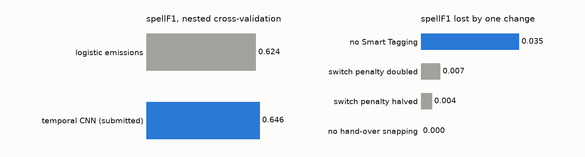

# Summary

We label every frame of FC Barcelona vs. Athletic Club as home possession, away possession or dead
ball. Evidence computed for each frame from the automatic tracking and the tactical tags goes into
a small temporal convolutional network, and a Viterbi decoder turns the network's output into
possessions that do not flicker. Everything that is learned or tuned comes from 27 open matches
from two other leagues. Nothing was fitted on the competition match. On those 27 matches the
pipeline reaches a `spellF1` of 0.646 and a `macroF1` of 0.892. A laptop CPU labels the whole match
in about 13 seconds, and a fresh clone of the repository reproduces the submitted file byte for
byte.

# 1. Approach

The task is to label each of the 199,319 frames of the match as `H`, `A`, `D` or `X`. The ranking
metric, `spellF1`, matches whole possessions one-to-one by how much they overlap in time, and that
shaped most of our decisions. A single wrong frame barely matters. What hurts is a possession that
flickers to the other team for half a second, because one correct possession then becomes three
wrong ones, and a boundary that lands a second late. So we never decide frame by frame. We collect
evidence for every frame and then ask which sequence of possessions is the most believable for the
whole half.

The pipeline has four steps:

1. **Per-frame evidence.** From the automatic tracking we compute, for each team and never for a
   single tracking slot (slots swap identities), the distance from the ball to the nearest player,
   whether that player is within 1.5 m, how many players are within 5 m, and ball touches. A touch
   is an abrupt change in ball velocity with a player in reach, and we keep both the last touch
   before a frame and the next one after it. We add each team's spread, the position of ball and
   players relative to the direction of attack, the collective player speed over 1 s and 3 s,
   whether the ball is still or out of bounds, and kick-off set-ups. Smart Tagging contributes a
   team prior from the phase tags, the first 5 s of every SET PIECES interval (plus the 2 s before
   it) and the whole of every GOALS interval.
2. **A temporal network.** A dilated residual 1-D convolutional network (9 blocks, 96 channels,
   dilations 1 to 256, roughly 20 s of context on either side) turns the evidence into three
   probabilities for every frame: home, away and dead. It is trained on external matches only
   (Section 3).
3. **Viterbi decoding.** The tempered log-probabilities are the emissions of a three-state Viterbi
   decoder with a fixed cost for each change: H↔A, alive→dead and dead→alive. These costs are what
   keep a possession in one piece. Frames before each half's kick-off are forced to `D`.
4. **Boundary snapping.** Each hand-over is moved to the first touch of the team taking over, if
   there is one within 0.53 s. Switching this step off changes the external score by less than
   0.001, because the network already places most hand-overs on the touch.

We never write `X` on a graded frame. The scorer fills an `X` with the previous label before it
computes `spellF1`, so abstaining can only repeat a decision the decoder has already made, and
`macroF1` counts it as a miss.

We considered simpler designs and rejected each for a concrete reason. A nearest-player rule with
smoothing, like the published baseline, cannot express that the ball is in the air between two
team-mates or that play has stopped. A frame classifier without a state model flickers. A set of
hand-written rules needs thresholds that we would have had to tune on this match, which the rules
forbid. A learned emission model combined with an explicit state model lets every constant be
either physical or fitted on other matches. Our first version used two logistic models as
emissions. The network is better, but not by much (Section 5).


**Figure 1.** Thirty seconds of an external Bundesliga match as the model receives it, with about a
third of the ball positions removed. The bars show the true possession and our labels. The short
home possession in the middle is missed, which is our most common kind of error.

# 2. Assets Used and Dropped

Table 1 lists every asset in the data bundle and what we did with it.

**Table 1.** Assets of the data bundle.

<!-- table: widths=27,9,64 align=l,c,l -->
| Asset | Used | How, or why not |
|---|---|---|
| Tactical ATD (ball and 46 slots) | Yes | Source of all geometric and kinematic features. The team of each slot comes from the metadata; home is the first team. |
| Tactical Smart Tagging | Yes | Team prior from the phase tags, set-piece and goal windows. Treated as evidence and never copied into the labels. |
| Tactical homography | No | The ATD is already in pitch coordinates, and nothing we compute needs pixels. |
| Broadcast ATD, homography and video | No | A different timeline from the tactical one, with lower coverage. |
| Tactical video | No | See Section 8. |
| ATD speed channel | No | We recompute velocities from positions, so the competition match and the external matches go through the same arithmetic. |

The ball is missing on about 41% of the graded frames. Gaps of up to 1 s are bridged linearly. In
longer gaps the ball features are empty, and the network has to rely on team shape, collective
movement and tags. A ball sample that lies more than two frames of travel at 40 m/s away from both
of its neighbours is dropped as a false detection. Player features are computed per team and use
medians, so a slot swap moves them very little.

# 3. External Data, Training and Tuning

All fitting happens on 27 external matches (Table 2). None of the labels were made by us, and none
come from the provided match.

**Table 2.** Labelled datasets used for training and tuning.

<!-- table: widths=24,22,22,21,11 align=l,l,l,l,c -->
| Dataset | Amount | Labels used | Labelled by | Licence |
|---|---|---|---|---|
| IDSSE, DFL Bundesliga 2022/23 [1] | 7 matches, 11.1 h, 1.0 M frames at 25 fps | Ball status (alive or dead) and ball possession (home or away), per frame | The DFL's official position-data feed, published with the dataset | CC BY 4.0 |
| SkillCorner Open Data, A-League 2024/25 [2] | 20 matches, 32.8 h, 3.0 M frames (10 fps, resampled to 25) | Possession group per frame and phases of play | SkillCorner, as published in its open-data repository | MIT |

**Label mapping.** Neither dataset uses the competition's definition of possession, so we map both
onto it. A spell shorter than 2 s is given back to the possession it interrupts, unless it comes
straight after a restart. This matters most for IDSSE, where possession switches on every touch.
SkillCorner frames outside a phase of play are dead.

**Degradation.** We then make each match look like uncorrected automatic tracking, at four levels:
the ball is removed in blocks on 20, 35, 50 or 60% of the frames, and we add position noise, player
dropouts and slot swaps.

**Imitation tags.** Neither dataset has Smart Tagging, so we generate imitation tags from each
match's labels. Set pieces are fixed 35 s windows that open a few seconds before the restart (5 s
for kick-offs). Goal intervals run from the build-up until after the kick-off. Phases are windows
of 10 to 30 s that come in attack and defend pairs and often outlive the possession they start in.
Restarts are missed, teams are missing or wrong, and some phases are false positives. Every
configuration is also scored with no tags at all. This is the second version of the imitation;
Section 8 explains why the first one was replaced.

**Training.** The network is trained with PyTorch on a laptop GPU (RTX 4050, 6 GB) for 6,000 steps
on crops of 4,096 frames, with AdamW (weight decay 0.001), a one-cycle learning rate up to 0.002,
dropout 0.25, tag dropout and a team swap, in which home and away inputs and labels are exchanged.
The final model is trained on all 27 matches at all four levels in about 14 minutes. The weights
are committed as JSON, and inference is reimplemented in numpy with 64-bit floats, so producing the
submission needs neither PyTorch nor a GPU.

**Tuning.** We first ran 5-fold cross-validation with matches grouped, so that every match is
scored by a network that never saw it. On those out-of-fold outputs, a random search over 150
configurations picks the emission temperature, a dead-ball offset, the three Viterbi costs and the
snap window. The objective is the mean `spellF1` minus half its standard deviation across matches.
Repeating the search with each match left out in turn gives the nested estimate in Section 5.
Every constant, its source and the script that produced it are listed in `docs/PRIORS.md`.

# 4. Possession Rules

The full rules follow `CHALLENGE.md` and are written up in `docs/POSSESSION_RULES.md`. These are
the main lines we drew.

**Dead ball.** A dead ball runs from the moment the ball leaves the pitch or play stops until the
restart is taken. The evidence is the ball last seen more than 0.5 m beyond a line (Law 9, plus an
allowance for tracking jitter), players walking together while the ball is still or unseen,
kick-off set-ups and Smart Tagging windows. None of these is a hard rule. Only the period
boundaries are, so frames before each half's kick-off are `D`.

**Restarts.** After a stoppage the restarting team has the ball. When the tag names a team, it
pushes the first frames towards that team. When the tag says `N/A`, which covers every throw-in and
every kick-off after a goal, the first controlled touch decides. A GOALS tag names the scoring
side, so the kick-off that follows belongs to the other team. We checked this reading on the match
by counting only: 4 consistent, 0 inconsistent.

**Loose and contested balls.** The ball stays with the team in possession until the evidence for
the other team is strong and lasts long enough to outweigh the switch cost. The change is then
placed at the first touch of the team taking over.

# 5. Results

## 5.1 External Benchmark

Table 3 gives the scores on the 27 external matches. "Balanced" means the average of the IDSSE
mean and the SkillCorner mean, so that the 20 SkillCorner matches do not outweigh the 7 IDSSE ones.
The nested rows re-select the decoder costs without the scored match and are the honest estimate.
Full tables are in `docs/BENCHMARK.md`.

**Table 3.** `spellF1` and `macroF1` on the external benchmark.

<!-- table: widths=28,27,14,19,12 align=l,l,c,c,c -->
| Emission model | Evaluation | Balanced spellF1 | Mean over matches (min–max) | Balanced macroF1 |
|---|---|---|---|---|
| Logistic + Viterbi | Nested, leave one match out | 0.624 | 0.607 (0.518–0.688) | – |
| Temporal CNN (submitted) | 5-fold, nested decoder selection | 0.646 | 0.622 (0.508–0.727) | – |
| Temporal CNN (submitted) | 5-fold, locked decoder | 0.646 | – | 0.892 |

With the locked decoder the two datasets differ: 0.695 on IDSSE and 0.596 on SkillCorner.



**Figure 2.** Left: `spellF1` of the logistic and the network emission models on the external
matches (nested estimates). Right: `spellF1` lost by changing one part of the submitted pipeline.

Removing Smart Tagging costs 0.035 `spellF1`. Halving or doubling the switch cost costs 0.004 and
0.007. Hand-over snapping and kick-off forcing each change the score by less than 0.001. When the
network is retrained on one fold without one group of inputs, it loses 0.029 without tags and 0.026
without team shape, and 0.004 or less without proximity, touches or stoppage features, which
overlap with each other.

The tuned values do not sit on a narrow peak. Scaling each decoder constant by 0.5 or 1.5, one at
a time, moves the external `spellF1` by at most 0.013 (halving the emission temperature), and every
other change stays within 0.005.


**Figure 3.** The first ten minutes of an external match: the true labels, our labels and the
frames in which the ball was tracked.

## 5.2 Public Five Minutes

We scored the public five minutes only after the parameters were locked. This happened twice, once
for each locked version (Section 8), and neither result was used to choose anything.

**Table 4.** Scores on the public five minutes, which contain 17 possessions. Bootstrap 5–95%
intervals in brackets. The baseline is the organisers' `baseline_smooth125`.

<!-- table: widths=37,25,25,13 align=l,c,c,c -->
| Submission | spellF1 | macroF1 | Possessions |
|---|---|---|---|
| Agamemnon, submitted version | 0.457 (0.243–0.671) | 0.877 (0.610–0.929) | 11 |
| Agamemnon, first locked version | 0.519 (0.311–0.710) | 0.845 (0.605–0.924) | 10 |
| Best published baseline | 0.424 | 0.581 | 16 |

With only 17 possessions the intervals are wide. Each one contains the other version's score, and
both contain the external estimate. We read this as a check that the pipeline works on this match.
It is not a prediction of the full-match score, and it is not a comparison of the two versions.

# 6. Limitations and Next Steps

**Too few possessions.** This is our clearest weakness. On the public slice we predict 11
possessions where there are 17, and on the full match 156 per 90 minutes. On the first external
match the same pipeline predicts 187 where the labels have 239. Short possessions get merged into
their neighbours. A lower switch cost would split more of them, but on the external matches it
does not raise `spellF1` (0.646 falls to 0.642 when the cost is halved), because a short possession
placed wrongly costs more than one that is missed.

**The imitation tags remain a guess.** We know the window lengths of the real tags, but not how
well their timing and teams line up with play, and that alignment decides what they are worth.
When we swap in tags from a second generator, in either the fixed-window style or the older style
aligned to possessions, the external score moves by about 0.01. Without any tags it is 0.61. The
damage from a wrong guess is therefore bounded.

**SkillCorner is weaker than IDSSE** (0.596 against 0.695), partly because its dead-ball labels
come from phase boundaries and not from a tracking flag.

**The network adds little.** It is only 0.02 ahead of two logistic models on this benchmark. Most
of the score comes from the features and the decoder, and that is where further work should go.

With more time we would try a duration model (semi-Markov decoding), so that a short possession is
not priced like flicker. We would also add external leagues that have a ball-status flag, and
measure how real automatic tracking degrades on public data instead of choosing ranges.

# 7. Reproduction

```
git clone https://github.com/agamemnon-labs/football-analytics.git
cd football-analytics
# put the match bundle in data/ (see DATA.md) or set MTAH_DATA_DIR
bash scripts/reproduce.sh
```

The script installs the pinned CPU requirements, runs the tests, writes the submission file to
`evaluation/results/`, validates it and prints its md5. We used Python 3.12.12 with
numpy 2.5.4, pandas 2.3.3, scipy 1.18.1 and lxml 5.4.0. On an Intel Core i5-13450HX with 16 GB of
RAM the pipeline takes about 13 s, and the whole script about 30 s once the packages are cached.

A fresh clone with a fresh virtual environment gives the md5 `1b0da3466b8663978d894daa2aa92434`,
the same as our working copy. The file is also identical when numpy is forced onto other BLAS
kernels and thread counts. The test suite repeats the md5 check on every run, and a second test
checks the network and the decoder against a recorded digest on Linux, Windows and macOS in CI.

Retraining is optional and needs PyTorch 2.6 with CUDA (`requirements-train.txt`). The steps are
listed in `docs/BENCHMARK.md`. GPU training uses fast non-deterministic kernels, so retrained
weights differ in the last digits; the submission is defined by the committed weights. The figures
come from `scripts/make_figures.py`, and this document is built by `scripts/build_report.py`.

# 8. Development Protocol

## 8.1 Data Handling

Our code touched the competition data only through the loader and a schema script that prints
column names, counts and ranges. We worked from aggregate outputs: counts, shares and scores.
Assumptions about the format came from `DATA.md` and are enforced by assertions in the loader.

Nothing was fitted, tuned or calibrated on the competition match or its ground truth. All learned
weights and tuned constants come from the external matches, and `docs/PRIORS.md` lists each one
with its source. We ran an aggregate sanity report on the match only to look for bugs, and it
raised no flags. No hand labels and no other human-produced data about this match were used.

## 8.2 The Amendment of 14 November

The parameters were first locked in commit `f30c2ba` on 6 November 2026. That commit was on GitHub
before the public ground truth was scored for the first time (6 November, 14:31 UTC, tag
`phase1-submission`).

On 14 November we changed the pipeline once, and we want to be plain about it. A review of our own
benchmark found that the imitation tags did not have the structure of the tagging we were given.
Ours were short windows cut at the labelled possession edges. The real file, of which we looked at
interval lengths and tag counts only, holds fixed 35 s set-piece windows, goal intervals of one and
a half to four minutes that include the kick-off, and overlapping phase windows of 10 to 30 s. A
network trained on the first kind learns to trust the edges of the tags. Scored out of fold on the
external matches with imitation tags of the real structure, the first version fell from 0.70 to
0.58 `spellF1`, below its own score without tags.

So we rebuilt the imitation, changed how the two tag windows are read (Section 1), retrained the
network and retuned the decoder, all on the external matches. The new values were locked in commit
`c395595`, pushed, and then scored once on the public slice (14 November, 04:26 UTC).

The cause of the change was the structure of an input file, not a score, and the public ground
truth played no part in it. The amended version scores lower on the public five minutes than the
first one did on `spellF1` (0.457 against 0.519) and higher on `macroF1`. We submit it anyway. The
difference is well inside the bootstrap interval, and choosing between versions by that number
would be tuning on the ground truth. Both versions can be regenerated from the repository: the
first from the tag, the submitted one from `main`.

# 9. Team

**Table 5.** Team Agamemnon.

<!-- table: widths=30,70 align=l,l -->
| Member | Role |
|---|---|
| Naufal Fahrozi | Team lead and systems: repository, loader, converters, pipeline, packaging |
| Raymond Thymotimmanuel | Football domain: possession and dead-ball rules, external label mapping, restarts |
| Tua Delima Sitompul | Data science: features, network, decoder, benchmark, tuning and ablations |

# References

[1] Bassek, M., Rein, R., Weber, H. and Memmert, D. An integrated dataset of spatiotemporal and
event data in elite soccer. *Scientific Data* 12, 195 (2025). doi:10.1038/s41597-025-04505-y. Data
© DFL Deutsche Fußball Liga, CC BY 4.0.

[2] SkillCorner. SkillCorner Open Data: broadcast tracking data, A-League 2024/25.
github.com/SkillCorner/opendata (commit 4340d27). MIT licence.

[3] Metrica Sports. More than a Hack 2027, Phase 1: starter kit and scorer.
github.com/metrica-sports/more-than-a-hack-2027. MIT licence.
