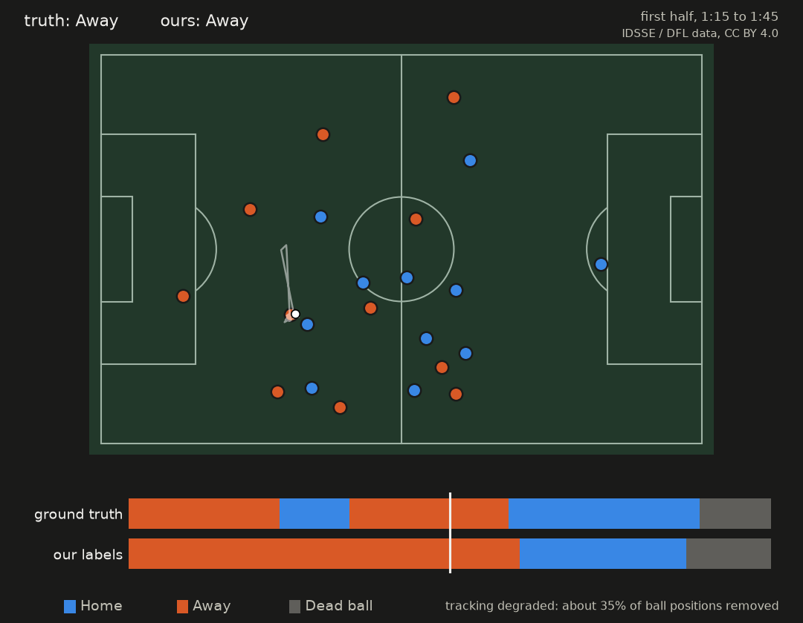
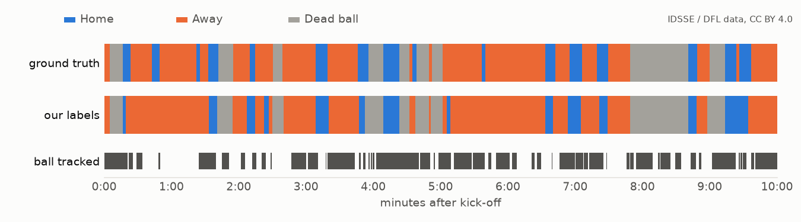

# The Short Version

We label every frame of FC Barcelona vs. Athletic Club as home possession, away possession or dead
ball. For each frame we work out a set of clues from the tracking and the tactical tags, a small
neural network turns those clues into probabilities, and a Viterbi decoder picks the sequence of
possessions that makes the most sense for the whole half. Everything the model knows, it learned
from 27 open matches from two other leagues. We didn't fit or tune anything on the competition
match. On those 27 matches we get a `spellF1` of 0.646 and a `macroF1` of 0.892. Labelling the whole
match takes about 13 seconds on a laptop CPU, and if you clone the repository you get exactly the
same file we submitted, byte for byte.

# 1. Approach

We have to give each of the 199,319 frames one label: `H`, `A`, `D` or `X`. The ranking metric,
`spellF1`, doesn't look at single frames. It matches whole possessions against the true ones by
how much they overlap in time, and that drove most of our choices. One wrong frame hardly matters.
What really costs points is a possession that flips to the other team for half a second, because
then one correct possession turns into three wrong ones. A boundary that lands a second late hurts
too. So we don't make the call frame by frame. We gather clues for every frame first, and then ask
which story fits the whole half best.

Here is how it works, in four steps:

1. **Gather clues.** For every frame we compute how far the ball is from each team's nearest
   player, whether that player is within 1.5 m, how many players are within 5 m, and who touched
   the ball. A touch is the ball suddenly changing speed or direction with a player close enough to
   have done it, and we keep both the last touch before a frame and the next one after it. On top
   of that come each team's spread, where the ball and players are relative to the direction of
   attack, how fast the players are moving as a group over 1 s and 3 s, whether the ball is still
   or out of bounds, and kick-off line-ups. We always work per team and never per tracking slot,
   because slots swap identities. Smart Tagging adds a hint about which team is attacking, the
   first 5 s of every SET PIECES interval (plus the 2 s before it) and the whole of every GOALS
   interval.
2. **Let a small network read them.** A 1-D convolutional network (9 residual blocks, 96 channels,
   dilations from 1 to 256, so about 20 s of context on each side) turns the clues into three
   probabilities per frame: home, away, dead. It was trained only on other matches (Section 3).
3. **Pick the story.** A three-state Viterbi decoder takes those probabilities and finds the best
   sequence for each half. Every change costs something: H↔A, alive→dead and dead→alive each have
   a fixed price. That price is what keeps a possession in one piece. Frames before each half's
   kick-off are always `D`.
4. **Tidy the edges.** Each hand-over is moved to the first touch of the team taking over, if there
   is one within 0.53 s. To be honest this step barely matters (less than 0.001 on the external
   score), because the network already puts most hand-overs on the touch.

We never write `X` on a graded frame. The scorer replaces an `X` with the previous label before
computing `spellF1`, so abstaining just repeats what the decoder already decided, and `macroF1`
counts it as a miss.

We did think about simpler designs, and each one fell over somewhere. "Nearest player has the
ball", even with smoothing, can't tell that the ball is in the air between two team-mates, or that
play has stopped. A classifier with no memory flickers. Hand-written rules need thresholds, and
we would have had to tune those on this match, which isn't allowed. A learned model for the clues
plus an explicit model for the sequence means every number is either physics or was fitted on
other matches. Our first version used two logistic regressions instead of the network. The
network is better, but not by much (Section 5).



**Figure 1.** Thirty seconds of a Bundesliga match from our benchmark, the way the model sees it,
with about a third of the ball positions deleted. The bars are the true possession and our labels.
We miss the short home possession in the middle, which is the kind of mistake we make most often.

# 2. Assets Used and Dropped

Table 1 goes through everything in the data bundle and what we did with it.

**Table 1.** What we used from the data bundle, and what we left out.

<!-- table: widths=27,9,64 align=l,c,l -->
| Asset | Used | How, or why not |
|---|---|---|
| Tactical ATD (ball and 46 slots) | Yes | All our geometric and movement clues come from here. Each slot's team comes from the metadata, and home is the first team. |
| Tactical Smart Tagging | Yes | A hint about the attacking team, plus set-piece and goal windows. We treat it as evidence and never copy it into the labels. |
| Tactical homography | No | The ATD is already in pitch coordinates, and nothing we compute needs pixels. |
| Broadcast ATD, homography and video | No | It runs on a different timeline from the tactical data and covers less of the pitch. |
| Tactical video | No | See Section 8. |
| ATD speed channel | No | We recompute speeds from positions, so the competition match and the external matches go through exactly the same maths. |

The ball is missing on about 41% of the graded frames. We bridge gaps of up to 1 s with a straight
line. In longer gaps the ball clues are simply empty, and the network has to lean on team shape,
group movement and tags. If a ball sample is further from both of its neighbours than two frames
of travel at 40 m/s, we treat it as a false detection and drop it. Player clues are computed per
team and use medians, so a swapped slot hardly moves them.

# 3. External Data, Training and Tuning

All the fitting happens on 27 matches from outside the competition (Table 2). We didn't label any
of them ourselves, and none of the labels come from the provided match.

**Table 2.** The labelled datasets we trained and tuned on.

<!-- table: widths=24,22,22,21,11 align=l,l,l,l,c -->
| Dataset | Amount | Labels used | Labelled by | Licence |
|---|---|---|---|---|
| IDSSE, DFL Bundesliga 2022/23 [1] | 7 matches, 11.1 h, 1.0 M frames at 25 fps | Ball status (alive or dead) and ball possession (home or away), per frame | The DFL's official position-data feed, published with the dataset | CC BY 4.0 |
| SkillCorner Open Data, A-League 2024/25 [2] | 20 matches, 32.8 h, 3.0 M frames (10 fps, resampled to 25) | Possession group per frame and phases of play | SkillCorner, as published in its open-data repository | MIT |

**Matching the labels.** Neither dataset defines possession the way the competition does, so we
translate both. A spell shorter than 2 s goes back to the possession it interrupts, unless it comes
right after a restart. This matters most for IDSSE, where possession changes on every single
touch. In SkillCorner, frames outside a phase of play count as dead.

**Making the tracking worse.** Both datasets are cleaner than automatic tracking, so we damage them
on purpose, at four levels: we delete the ball in chunks on 20, 35, 50 or 60% of the frames, add
position noise, make players drop out for a moment and swap slots.

**Faking the tags.** Neither dataset comes with Smart Tagging, so we generate imitation tags from
each match's labels. Set pieces are fixed 35 s windows that open a few seconds before the restart
(5 s for kick-offs). Goal intervals run from the build-up until after the kick-off. Phases are
windows of 10 to 30 s that come in attack and defend pairs and often run past the possession they
started in. We also make them unreliable: restarts get missed, teams are missing or wrong, and
some phases are false alarms. Every setup is also scored with no tags at all. This is our second
attempt at the imitation, and Section 8 explains what was wrong with the first.

**Training.** The network trains in PyTorch on a laptop GPU (RTX 4050, 6 GB) for 6,000 steps on
crops of 4,096 frames, with AdamW (weight decay 0.001), a one-cycle learning rate up to 0.002,
dropout 0.25, tag dropout and a team swap, where we exchange home and away in both inputs and
labels. The final model sees all 27 matches at all four damage levels and takes about 14 minutes.
We commit the weights as JSON and run inference in plain numpy with 64-bit floats, so you need
neither PyTorch nor a GPU to produce the submission.

**Tuning.** First we ran 5-fold cross-validation with matches kept together, so every match is
scored by a network that has never seen it. On those outputs, a random search over 150
configurations picks the emission temperature, a dead-ball offset, the three Viterbi prices and
the snap window. We maximise the mean `spellF1` minus half its standard deviation across matches,
because we want settings that work everywhere and not ones that shine on a few matches. Repeating
the search with each match left out in turn gives the nested estimate in Section 5. Every number
in the pipeline, where it came from and which script produced it are in `docs/PRIORS.md`.

# 4. Possession Rules

The full write-up follows `CHALLENGE.md` and lives in `docs/POSSESSION_RULES.md`. These are the
main calls we made.

**Dead ball.** The ball is dead from the moment it leaves the pitch or play stops until the
restart is taken. Our clues for that are the ball last seen more than 0.5 m past a line (Law 9,
plus a bit of slack for tracking jitter), players walking around together while the ball is still
or out of sight, kick-off line-ups and Smart Tagging windows. None of these is a hard rule. The
only hard rule is the period boundaries, so frames before each half's kick-off are `D`.

**Restarts.** After a stoppage, the team taking the restart has the ball. If the tag names a
team, it nudges the first frames towards that team. If the tag says `N/A`, which is the case for
every throw-in and every kick-off after a goal, the first controlled touch decides. A GOALS tag
names the team that scored, so the kick-off after it belongs to the other team. We checked that
reading on the match by counting only: 4 consistent, 0 inconsistent.

**Loose balls and challenges.** The ball stays with the team that had it until the evidence for
the other team is strong and lasts long enough to be worth the switching price. A defender getting
a toe on the ball isn't a turnover. When possession does change, we put the change at the first
touch of the team taking over.

# 5. Results

## 5.1 External Benchmark

Table 3 shows how we do on the 27 external matches. "Balanced" means we average the IDSSE mean
and the SkillCorner mean, so the 20 SkillCorner matches don't drown out the 7 IDSSE ones. In the
nested rows the decoder prices are chosen without the match being scored, so those are the honest
numbers. The full tables are in `docs/BENCHMARK.md`.

**Table 3.** `spellF1` and `macroF1` on the external benchmark.

<!-- table: widths=28,27,14,19,12 align=l,l,c,c,c -->
| Emission model | Evaluation | Balanced spellF1 | Mean over matches (min–max) | Balanced macroF1 |
|---|---|---|---|---|
| Logistic + Viterbi | Nested, leave one match out | 0.624 | 0.607 (0.518–0.688) | – |
| Temporal CNN (submitted) | 5-fold, nested decoder selection | 0.646 | 0.622 (0.508–0.727) | – |
| Temporal CNN (submitted) | 5-fold, locked decoder | 0.646 | – | 0.892 |

The two datasets aren't equally hard for us: with the locked decoder we get 0.695 on IDSSE and
0.596 on SkillCorner.


**Figure 2.** Left: `spellF1` of the logistic and the network versions on the external matches
(nested estimates). Right: how much `spellF1` we lose by changing one part of the submitted
pipeline.

Take away Smart Tagging and we lose 0.035 `spellF1`. Halve or double the switching price and we
lose 0.004 or 0.007. Snapping and kick-off forcing each move the score by less than 0.001. We also
retrained the network on one fold with one group of clues removed each time: it loses 0.029
without tags and 0.026 without team shape, and 0.004 or less without proximity, touches or the
stoppage clues, which mostly say the same thing as each other.

The tuned values aren't balanced on a knife edge either. Scale any one of them by 0.5 or 1.5 and
the external `spellF1` moves by at most 0.013 (that's halving the emission temperature). Every
other change stays within 0.005.



**Figure 3.** The first ten minutes of an external match: the true labels, our labels, and the
frames where the ball was actually tracked.

## 5.2 Public Five Minutes

We only scored the public five minutes after the parameters were locked. That happened twice,
once for each locked version (Section 8), and we didn't use either result to choose anything.

**Table 4.** Scores on the public five minutes, which contain 17 possessions. Bootstrap 5–95%
intervals in brackets. The baseline is the organisers' `baseline_smooth125`.

<!-- table: widths=37,25,25,13 align=l,c,c,c -->
| Submission | spellF1 | macroF1 | Possessions |
|---|---|---|---|
| Ours, submitted version | 0.457 (0.243–0.671) | 0.877 (0.610–0.929) | 11 |
| Ours, first locked version | 0.519 (0.311–0.710) | 0.845 (0.605–0.924) | 10 |
| Best published baseline | 0.424 | 0.581 | 16 |

Seventeen possessions is a tiny sample, so the intervals are wide. Each one contains the other
version's score, and both contain our external estimate. All this tells us is that the pipeline
isn't broken on this match. It doesn't predict the full-match score, and it doesn't tell us which
of the two versions is better.

# 6. Limitations and Next Steps

**We find too few possessions.** This is our clearest weakness. On the public slice we call 11
possessions where there are 17, and on the full match about 156 per 90 minutes. On the first
external match the same pipeline calls 187 where the labels have 239. Short possessions get
swallowed by their neighbours. A lower switching price would split more of them, but on the
external matches that doesn't help `spellF1` (0.646 drops to 0.642 when we halve it), because a
short possession in the wrong place costs more than one we simply miss.

**Our imitation tags are still a guess.** We know how long the real tag windows are. We don't know
how well their timing and teams line up with what happens on the pitch, and that is what decides
how useful they are. When we swap in tags from a second generator, either as fixed windows or in
the older style lined up with possessions, the external score moves by about 0.01. With no tags at
all it is 0.61. So if our guess is off, the damage is limited.

**SkillCorner is harder for us than IDSSE** (0.596 against 0.695). Part of the reason is that its
dead-ball labels come from where phases start and end, not from a proper ball-status flag.

**The network doesn't add much.** It is only 0.02 ahead of two logistic regressions on this
benchmark. Most of the score comes from the clues and the decoder, so that is where more work
would pay off.

If we had more time, we would try a decoder that models how long possessions last (a semi-Markov
model), so a short possession isn't priced like a flicker. We would also add more leagues that
have a ball-status flag, and measure how real automatic tracking goes wrong on public data
instead of picking ranges ourselves.

# 7. Reproduction

```
git clone https://github.com/agamemnon-labs/football-analytics.git
cd football-analytics
# put the match bundle in data/ (see DATA.md) or set MTAH_DATA_DIR
bash scripts/reproduce.sh
```

The script installs the pinned requirements (CPU only), runs the tests, writes the submission
file to `evaluation/results/`, validates it and prints its md5. We used Python 3.12.12 with numpy
2.5.4, pandas 2.3.3, scipy 1.18.1 and lxml 5.4.0. On an Intel Core i5-13450HX with 16 GB of RAM
the pipeline takes about 13 s, and the whole script about 30 s once the packages are cached.

A fresh clone with a fresh virtual environment gives the md5 `1b0da3466b8663978d894daa2aa92434`,
the same as our working copy. We also forced numpy onto other BLAS kernels and thread counts and
still got the same file. The tests repeat the md5 check on every run, and one more test checks
the network and decoder against a recorded digest on Linux, Windows and macOS in CI.

You don't need to retrain anything. If you want to, it needs PyTorch 2.6 with CUDA
(`requirements-train.txt`), and the steps are in `docs/BENCHMARK.md`. GPU training isn't
bit-for-bit repeatable, so retrained weights differ in the last digits; the submission is defined
by the weights in the repository. The figures and this document are built by scripts in the same
repository.

# 8. Development Protocol

## 8.1 How We Handled the Data

Our code only touched the competition data through the loader and a small script that prints
column names, counts and ranges. Everything we looked at was a summary: counts, shares and scores.
What we assumed about the format came from `DATA.md`, and the loader stops with an error if any
of it turns out to be wrong.

We didn't fit, tune or calibrate anything on the competition match or its ground truth. Every
learned weight and every tuned number comes from the external matches, and `docs/PRIORS.md` lists
each one with its source. We ran a summary sanity report on the match purely to catch bugs, and
it didn't flag anything. We used no hand labels and no other human-made data about this match.

## 8.2 The Change We Made on 14 November

We first locked the parameters in commit `f30c2ba` on 6 November 2026. That commit was on GitHub
before we scored the public ground truth for the first time (6 November, 14:31 UTC, tag
`phase1-submission`).

On 14 November we changed the pipeline, once, and we would rather explain it than hide it. While
reviewing our own benchmark we noticed that our imitation tags didn't look like the tags we were
actually given. Ours were short windows that started and stopped right at the labelled possession
edges. The real file is different. We only looked at its interval lengths and tag counts, and
those show fixed 35 s set-piece windows, goal intervals of one and a half to four minutes that
include the kick-off, and overlapping phase windows of 10 to 30 s. A network trained on our tidy
tags learns to trust tag edges that the real tags don't have. When we scored that first version
on the external matches with tags shaped like the real ones, it fell from 0.70 to 0.58 `spellF1`,
which is worse than it does with no tags at all.

So we rebuilt the imitation, changed how the two tag windows are read (Section 1), retrained the
network and retuned the decoder, all on the external matches. We locked the new values in commit
`c395595`, pushed it, and then scored the public slice once (14 November, 04:26 UTC).

What triggered the change was the structure of an input file, not a score, and the public ground
truth had nothing to do with it. The new version actually scores lower on the public five minutes
than the first one on `spellF1` (0.457 against 0.519), and higher on `macroF1`. We are submitting
it anyway. The gap is well inside the bootstrap interval, and picking a version because of that
number would be tuning on the ground truth. Both versions can be rebuilt from the repository: the
first from the tag, the submitted one from `main`.

# 9. Team

**Table 5.** Who did what.

<!-- table: widths=30,70 align=l,l -->
| Member | Role |
|---|---|
| Naufal Fahrozi | Team lead and systems: repository, loader, converters, pipeline, packaging |
| Raymond Thymotimmanuel | Football side: possession and dead-ball rules, external label mapping, restarts |
| Tua Delima Sitompul | Data science: clues, network, decoder, benchmark, tuning and ablations |

# References

[1] Bassek, M., Rein, R., Weber, H. and Memmert, D. An integrated dataset of spatiotemporal and
event data in elite soccer. *Scientific Data* 12, 195 (2025). doi:10.1038/s41597-025-04505-y. Data
© DFL Deutsche Fußball Liga, CC BY 4.0.

[2] SkillCorner. SkillCorner Open Data: broadcast tracking data, A-League 2024/25.
github.com/SkillCorner/opendata (commit 4340d27). MIT licence.

[3] Metrica Sports. More than a Hack 2027, Phase 1: starter kit and scorer.
github.com/metrica-sports/more-than-a-hack-2027. MIT licence.
