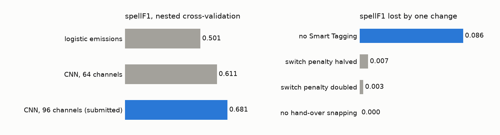
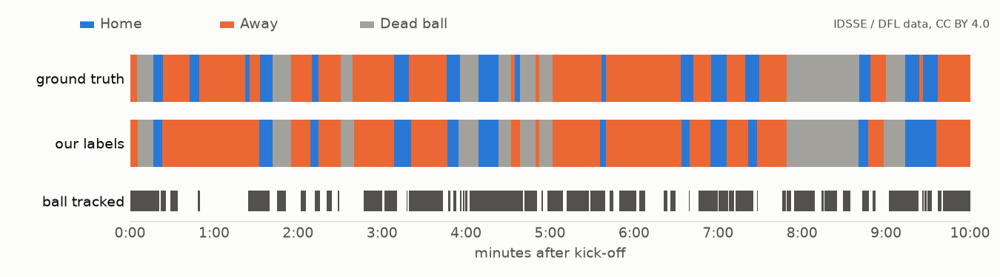

# 1. Approach

We have to label each of the 199,319 frames of FC Barcelona vs Athletic Club as `H`, `A`, `D` or
`X`. The ranking metric, `spellF1`, matches whole possessions one-to-one by temporal overlap, and
that shaped most of our decisions. A single wrong frame barely matters. What hurts is a possession
that flickers to the other team for half a second (one correct possession turns into three wrong
ones) and a boundary that lands a second late. So we never make the call frame by frame. We collect
evidence for every frame and then ask what the most believable sequence of possessions is for the
whole half.

The pipeline has four steps.

1. Per-frame evidence. From the automatic tracking we compute, per team and never per slot (slots
   swap identities), the distance from the ball to each side's nearest player, how many players of
   each side are within 1.5 m and 5 m, ball touches (an abrupt change in ball velocity with a
   player in reach; we keep both the last touch before a frame and the next one after it), each
   side's spread and the field position of ball and players relative to its attacking direction,
   collective player speed over 1 s and 3 s, whether the ball is still, out-of-bounds, and kick-off
   set-ups. Smart Tagging adds a team prior from phase tags, a window around each SET PIECES tag
   and a window after each GOALS tag.
2. A temporal network. A dilated residual 1-D CNN (9 blocks, 96 channels, dilations 1 to 256,
   roughly 20 s of context either side) turns the evidence into P(H), P(A) and P(D) for every
   frame. It is trained on external matches only (section 3).
3. Viterbi decoding. The tempered log-probabilities are emissions of a three-state Viterbi with a
   fixed cost for H<->A, alive->D and D->alive. Those costs are what keep a possession in one
   piece. Frames before each half's kick-off are forced to `D`.
4. Boundary snapping. Each hand-over is moved to the first touch of the team taking over, within
   0.22 s. The tuned window is short because the network already puts most hand-overs on the touch.

We never write `X` on a graded frame. The scorer fills an `X` with the previous label before
computing `spellF1`, so abstaining can only repeat a decision the decoder already makes, and
`macroF1` counts it as a miss.

We tried to talk ourselves into simpler designs and couldn't. A nearest-player rule with smoothing,
like the published baseline, has no way to say "the ball is in the air between two team-mates" or
"play has stopped". A frame classifier without a state model flickers like a VAR check that keeps
changing its mind. A hand-written rule set needs
thresholds that we would have had to tune on this match, which the rules forbid. A learned
emission model plus an explicit state model lets every constant be either physical or fitted on
other games. Our first version used two logistic models as emissions; moving to the network took
the external `spellF1` from 0.50 to 0.68.


# 2. Assets used and dropped

| asset | used | how |
|---|---|---|
| tactical ATD (ball + 46 slots) | yes | all geometric and kinematic features; slot team from the metadata, home = first team |
| tactical Smart Tagging | yes | team prior from phase tags, set-piece and goal windows; treated as evidence, never copied into labels |
| tactical homography | no | the ATD is already in pitch coordinates and nothing we compute needs pixels |
| broadcast ATD, homography, video | no | a different timeline from the tactical one, and lower coverage |
| tactical video | no | see section 8 |
| ATD speed channel | no | we recompute velocities from positions, so the competition match and the external games go through the same arithmetic |

The ball is missing on about 41% of graded frames. Gaps up to 1 s are bridged linearly; in longer
gaps the ball features are empty and the network has to rely on team shape, collective movement and
tags. Ball samples that imply more than 40 m/s to both neighbours are dropped as false detections.
Player features are per team and use medians, so a slot swap moves them very little.

# 3. External data, training and tuning

All fitting happens on 27 external matches (docs/EXTERNAL_DATA.md). None of the labels were made by
us, and none come from the provided game.

| dataset | amount | labels used | labels produced by | licence |
|---|---|---|---|---|
| IDSSE, DFL Bundesliga 2022/23 (Bassek et al., *Scientific Data* 12, 195, 2025) | 7 matches, 11.1 h, 1.0 M frames at 25 fps | per-frame ball status (alive/dead) and ball possession (home/away) | the DFL's official position-data feed, published with the dataset | CC BY 4.0 |
| SkillCorner Open Data, A-League 2024/25 | 20 matches, 32.8 h, 3.0 M frames (10 fps resampled to 25) | possession group per frame, phases of play | SkillCorner, as published in its open-data repository | MIT |

Neither dataset uses the competition's definition of possession, so we map them onto it. IDSSE
possession switches on every touch, so a spell shorter than 2 s is given back to the possession it
interrupts, unless it comes straight after a restart. SkillCorner frames outside a phase of play are
dead. We then make each match look like uncorrected automatic tracking, at four levels: the ball is
removed in blocks on 20, 35, 50 or 60% of frames, and we add position noise, player dropouts and slot
swaps. Since neither dataset has Smart Tagging, we generate imitation tags from its events with
timing errors, wrong teams, tags that run into the next possession and false positives, and every
configuration is also scored with no tags at all.

The network is trained with PyTorch on a laptop GPU (RTX 4050, 6 GB) for 6,000 steps on crops of
4,096 frames, with AdamW (weight decay 1e-3), a one-cycle learning rate up to 2e-3, dropout 0.25,
tag dropout, and a team swap (home and away inputs and labels exchanged). The final model is
trained on all 27 matches at all four levels in about 14 minutes. The weights are committed as JSON
and inference is reimplemented in numpy float64, so producing the submission needs neither PyTorch
nor a GPU.

For tuning, we first ran 5-fold cross-validation with matches grouped, so every match is scored by
a network that never saw it. On those out-of-fold outputs a random search over 150 configurations
picks the emission temperature, a dead-ball offset, the three Viterbi costs and the snap window,
maximising mean `spellF1` minus half its standard deviation across matches. Repeating the search
with each match left out in turn gives the nested estimate in section 5. Every constant, its source
and the script that produced it are listed in docs/PRIORS.md.

# 4. Possession rules implemented

The full rules, following CHALLENGE.md, are in docs/POSSESSION_RULES.md. The main lines we drew:

A dead ball runs from the moment the ball leaves the pitch or play stops until the restart is
taken. The evidence is the ball last seen more than 0.5 m beyond a line (Law 9 plus tracking
jitter), players walking together while the ball is still or unseen, kick-off set-ups, and Smart
Tagging windows. None of these is a hard rule; only the period boundaries are, so frames before
each half's kick-off are `D`.

After a stoppage the restarting team has the ball. When the tag's `Team` is valid it pushes the
first frames towards that team. With `N/A`, which covers every throw-in and every kick-off after a
goal, the first controlled touch decides. A GOALS tag names the scoring side (we checked this on the
match by counting only: 4 consistent, 0 inconsistent), so the kick-off that follows belongs to the
other team.

Loose and contested balls stay with the team in possession until the evidence for the other team
is strong and lasts long enough to outweigh the switch cost. A change is then placed at the taker's
first touch.

# 5. Results

Balanced means average the IDSSE mean and the SkillCorner mean, so the 20 SkillCorner matches do not
outweigh the 7 IDSSE ones. Full tables are in docs/BENCHMARK.md.

| emission model | evaluation | balanced spellF1 | balanced macroF1 |
|---|---|---|---|
| logistic + Viterbi | nested leave-one-match-out | 0.501 | |
| temporal CNN (submitted) | 5-fold, locked decoder | 0.703 (IDSSE 0.748, SkillCorner 0.657) | 0.908 |
| temporal CNN (submitted) | 5-fold, nested decoder selection | 0.681 (single matches 0.585 to 0.774) | |



Removing Smart Tagging costs 0.086 `spellF1`. Halving or doubling the switch cost costs 0.007 and
0.003, and hand-over snapping and kick-off forcing each change it by less than 0.002. Retraining
the network without one group of inputs on one fold costs at most 0.012 for proximity, touches,
team shape or stoppage features, against 0.088 for tags. Apart from the tags, the inputs overlap
enough that no single signal carries the model.

Scaling each tuned decoder constant by 0.5 or 1.5, one at a time, moves the external `spellF1` by
at most 0.007 (halving the switch cost); every other change stays within 0.004. The optimum is flat,
so the locked values are not sitting on a narrow peak.



We scored the public five minutes once, after the parameters were locked (section 8):

| | spellF1 | macroF1 | possessions (ground truth: 17) |
|---|---|---|---|
| Agamemnon | 0.519 (bootstrap 5-95%: 0.311 to 0.710) | 0.845 (0.605 to 0.924) | 10 |
| best published baseline (`baseline_smooth125`) | 0.424 | 0.581 | 16 |

With 17 possessions the interval is wide, and it contains the external estimate. We read this as a
check that the pipeline works on this match, not as a prediction of the full-match score.

# 6. Limitations and what we would do next

Our clearest weakness: we find too few possessions. On the public slice we predict 10 where
there are 17, and on the full match 163 per 90 minutes, against 210 to 240 on the external games.
Short possessions get merged into their neighbours. A lower switch cost would split more of them,
but on the external matches it lowers `spellF1` (0.703 to 0.696 when halved), because a short
possession placed wrongly costs more than one that is missed. We did not touch anything after
seeing the public slice. That would be tuning on this match, and the whole point of the exercise is
a pipeline that works on a match it has never seen.

SkillCorner is weaker than IDSSE (0.657 against 0.748), partly because its dead-ball labels come
from phase boundaries rather than a tracking flag. The tags are worth about 0.09, and without them
the external score is 0.62; our imitation tags are a guess at how the real tags go wrong.

With more time we would try a duration model (semi-Markov decoding), so that a short possession is
not priced like flicker, add more external leagues that have a ball-status flag, and measure the
degradation of real automatic tracking on public data instead of choosing ranges.

# 7. Reproduction

```
git clone https://github.com/agamemnon-labs/football-analytics.git
cd football-analytics
# put the match bundle in data/ (DATA.md) or set MTAH_DATA_DIR
bash scripts/reproduce.sh
```

`reproduce.sh` installs the pinned CPU requirements, runs the tests, writes
`evaluation/results/Agamemnon.csv`, validates it and prints its md5. We used Python 3.12.12 with
numpy 2.5.4, pandas 2.3.3, scipy 1.18.1 and lxml 5.4.0 (requirements.txt). On an Intel Core
i5-13450HX with 16 GB of RAM the pipeline takes about 12 s, and the whole script about 30 s once the
packages are cached. Two runs from a fresh clone and a fresh virtual environment gave the same md5,
`b627df9ec4abba265ecfdfec2e64271e`, and `tests/test_pipeline.py` repeats that check on every test
run.

Retraining is optional and needs `requirements-train.txt` (PyTorch 2.6 with CUDA):
`python scripts/fetch_external.py`, `python scripts/build_cells.py`,
`python scripts/train_tcn.py --folds 5 --name cv_w96`,
`python scripts/tune.py --emission network --oof cv_w96` and `python scripts/train_tcn.py --final`.
GPU training uses fast non-deterministic kernels, so retrained weights differ in the last digits;
the submission is defined by the committed weights. The figures come from
`python scripts/make_figures.py`, and this document is rendered with
`python scripts/build_report.py` (PDF) and `python scripts/build_docx.py` (Word).

# 8. Development protocol

Our code touched `data/` only through the loader, and we worked from aggregate outputs: counts,
shares and scores. Format assumptions came from DATA.md and are checked by hard assertions in the
loader.

Nothing was fitted, tuned or calibrated on the competition match or its ground truth. All learned
weights and tuned constants come from the external games, and docs/PRIORS.md lists each one with its
source. We ran an aggregate sanity report on the match (scripts/sanity_report.py) only to look for
bugs; it raised no flags and changed nothing.

The parameters were locked in commit `f30c2ba` ("docs(priors): lock parameters before public
evaluation"), which was on GitHub before the public ground truth was first scored at
2026-11-06 14:31 UTC. It was scored exactly once and no parameter changed afterwards. No hand labels
or other human-produced data about this match were used.

# 9. Team

| member | role |
|---|---|
| Naufal Fahrozi | team lead and systems: repository, loader, converters, pipeline, packaging |
| Raymond Thymotimmanuel | football domain: possession and dead-ball rules, external label mapping, restarts |
| Tua Delima Sitompul | data science: features, network, decoder, benchmark, tuning and ablations |
